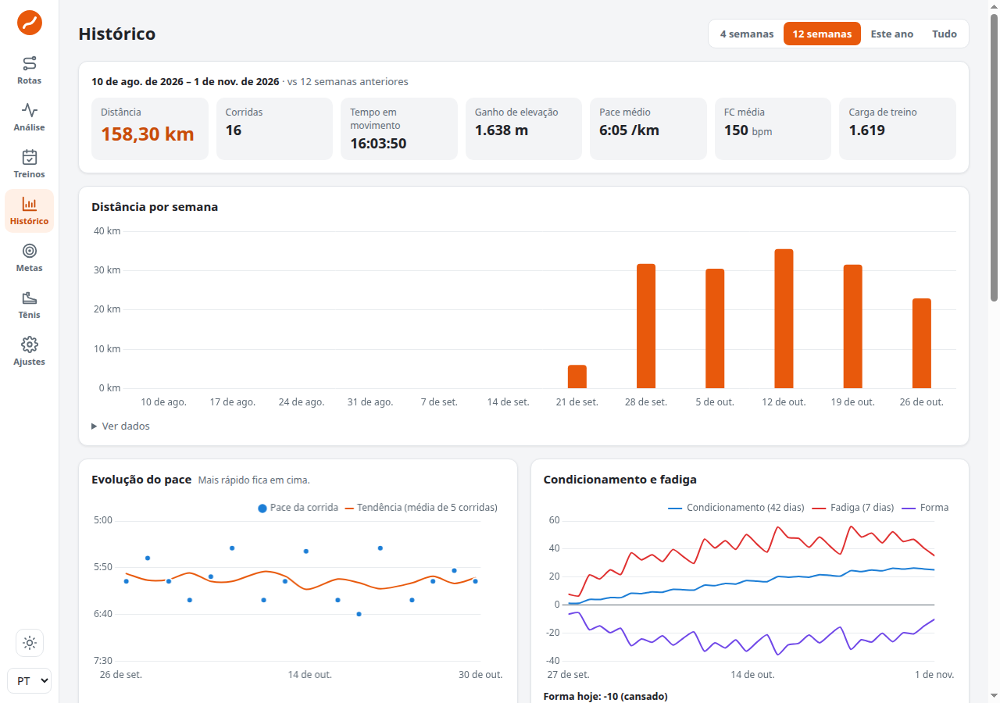
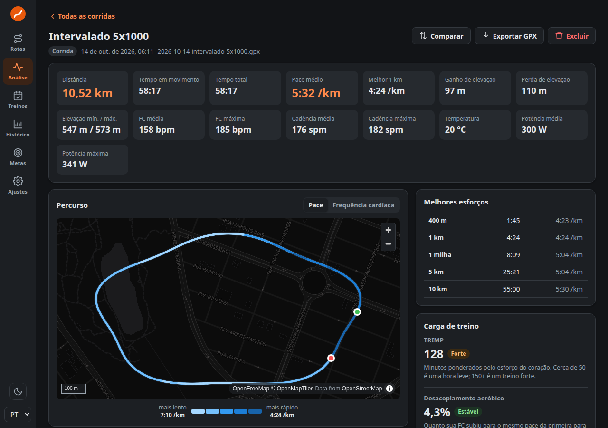

# Lapwing 🐦

**Português** · [English](README.en.md)

**Crie rotas de corrida, entenda seus treinos e acompanhe sua evolução, tudo no seu navegador.**

*Lapwing* é o nome em inglês do **quero-quero**, aquele passarinho que vive correndo pelos gramados. Combina com quem gosta de correr, não é? 😊

O Lapwing foi feito para quem corre por prazer, por saúde ou para bater recordes. Você não precisa de conta, assinatura nem cadastro. Abra e use.



---

## O que dá para fazer

| | Tela | Para que serve |
|---|---|---|
| 🗺️ | **Rotas** | Desenhe um percurso clicando no mapa. O Lapwing segue ruas e trilhas sozinho, mostra a distância e a subida, e calcula quanto tempo você vai levar no seu ritmo. Depois é só exportar para o relógio (GPX). |
| 📈 | **Análise** | Importe suas corridas (arquivos GPX, FIT ou TCX do Strava, Garmin ou outro relógio) e veja um relatório completo: mapa, ritmo, batimentos, parciais por km e seus melhores tempos. Quer trazer tudo de uma vez? Solte o arquivo completo da sua conta do Strava, mesmo sem assinatura. |
| 📅 | **Treinos** | Monte um plano para a sua próxima prova, ou peça para o Lapwing gerar um. Ele marca sozinho os treinos que você já fez e exporta o plano para o calendário ou para o relógio. |
| 📊 | **Histórico** | Veja quanto você correu por semana, como seu ritmo evolui, seus recordes e um calendário com todos os seus dias de corrida. Dá para filtrar por distância, ritmo, subida e mais. |
| ⚖️ | **Comparar** | Coloque duas corridas lado a lado e descubra onde você foi mais rápido. |
| 🎯 | **Metas** | Crie metas semanais ou mensais, veja uma estimativa do seu tempo nos 5 km, 10 km, meia e maratona, e receba avisos quando estiver treinando demais. |
| ⚙️ | **Ajustes** | Escolha tema claro ou escuro, conecte o Strava (se quiser; exige assinatura do Strava) e faça backup dos seus dados. |

O app funciona em **português** e **inglês**, no computador e no celular.



---

## Seus dados são seus 🔒

- Tudo o que você importa ou cria fica **guardado só no seu navegador**, neste aparelho.
- O Lapwing **não tem servidor** e não envia suas corridas para lugar nenhum.
- A internet é usada só para três coisas: carregar o **mapa** (OpenFreeMap), **calcular caminhos** no editor de rotas (BRouter) e, se você quiser, **buscar corridas no Strava** (disponível para assinantes do Strava).
- Para não perder nada, use **Ajustes → Backup e restauração** de vez em quando. Assim você também pode levar seus dados para outro computador.

Mais detalhes em [Privacidade](docs/privacy.md).

---

## Como começar

### Só quero usar

Se alguém já publicou o Lapwing num site, é só abrir o endereço no navegador. Pronto! Comece por:

1. **Rotas**: clique no mapa para desenhar seu próximo treino.
2. **Análise**: arraste seus arquivos de corrida (GPX, FIT ou TCX) para ver seus relatórios. Usa o Strava? Peça o arquivo da sua conta em **Configurações → Minha conta → Baixar ou excluir sua conta** e solte o `.zip` inteiro, sem descompactar: todo o seu histórico entra de uma vez, e não precisa de assinatura.
3. **Ajustes**: escolha o tema e faça seu primeiro backup.

O passo a passo completo está em [Primeiros passos](docs/getting-started/first-steps.md).

### Quero rodar no meu computador

Você vai precisar do [Node.js](https://nodejs.org/) (versão 20.19 ou mais nova, ou 22.12 ou mais nova). No terminal, dentro da pasta do projeto:

```bash
npm install     # baixa o que o app precisa (só na primeira vez)
npm run dev     # abre o app em http://localhost:5173
```

Para gerar a versão final, que dá para publicar em qualquer hospedagem de site estático:

```bash
npm run build   # confere o código, roda as verificações e gera a pasta dist/
```

Veja todos os detalhes em [Instalar e rodar](docs/getting-started/install-and-run.md).

### Quero subir num servidor com Docker 🐳

Não precisa instalar o Node. Com o [Docker](https://docs.docker.com/get-docker/) instalado, dentro da pasta do projeto:

```bash
docker compose up -d --build   # gera a imagem e sobe o app em http://localhost:8080
```

Para atualizar depois, é só `git pull` e o mesmo comando. Porta, subpasta, HTTPS e dicas estão em [Rodar com Docker](docs/getting-started/docker.md).

---

## Documentação 📚

A documentação fica na pasta [`docs/`](docs/README.md) e é organizada como uma **árvore**. Cada pasta tem um índice, e cada página mostra onde ela está na árvore. Isso facilita a leitura tanto para pessoas quanto para assistentes de IA.

```
docs/
├── README.md          ← comece por aqui (mapa completo)
├── overview.md        — o que é o Lapwing e como ele pensa
├── getting-started/   — instalar, rodar (inclusive com Docker) e dar os primeiros passos
├── features/          — guia de cada tela, em linguagem simples
├── architecture/      — como o código funciona por dentro
├── development/       — como contribuir: comandos, testes e convenções
├── reference/         — formatos de arquivo, comandos e glossário
├── privacy.md         — onde ficam seus dados
└── faq.md             — perguntas frequentes
```

---

## Quer ajudar? 🤝

Toda ajuda é bem-vinda: uma ideia, um erro encontrado, uma tradução melhor ou um pedaço de código.

- Antes de mexer no código, leia [Desenvolvimento](docs/development/README.md).
- Rode `npm test` e `npm run build` antes de enviar sua mudança.
- Escreva os textos novos em **português e inglês**.

---

## Agradecimentos 💛

O Lapwing existe graças a projetos abertos incríveis:

- [OpenStreetMap](https://www.openstreetmap.org/) e seus colaboradores, pelos dados do mapa
- [OpenFreeMap](https://openfreemap.org/), pelos mapas gratuitos
- [BRouter](https://brouter.de/), pelo cálculo de caminhos
- [MapLibre](https://maplibre.org/) e [Chart.js](https://www.chartjs.org/), pelo mapa e pelos gráficos

O Lapwing não tem ligação oficial com o Strava, a Garmin ou outras marcas citadas.

---

## Licença

Distribuído sob a licença **MIT**: você pode usar, copiar, modificar e compartilhar à vontade, desde que mantenha o aviso de direitos autorais. Veja o arquivo [LICENSE](LICENSE).

Feito com carinho para quem ama correr. Bons treinos! 🏃‍♀️🏃‍♂️
