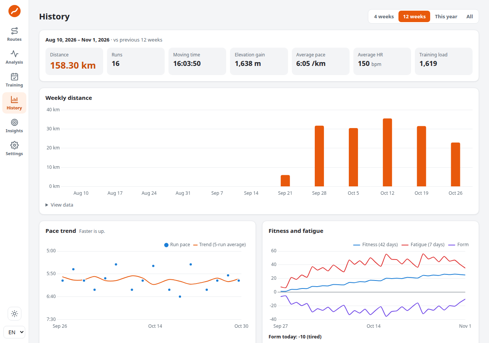
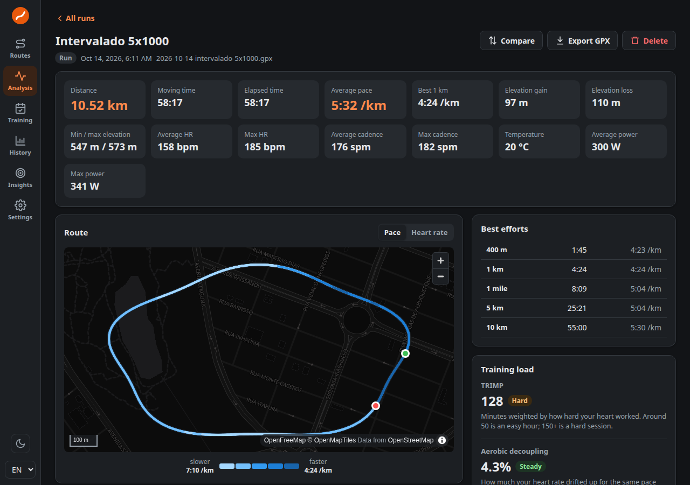

# Lapwing 🐦

**Inglês** · [Português](README.pt.md)

**Plan running routes, understand your workouts and track your progress, all in your browser.**

*Lapwing* is the English name of the **quero-quero**, the little bird that is always running around Brazilian lawns. A good fit for people who love to run, don't you think? 😊

Lapwing is made for people who run for fun, for their health or to set new records. You don't need an account, a subscription or a sign-up. Just open it and go.



---

## What you can do

| | Screen | What it's for |
|---|---|---|
| ☀️ | **Today** | The home screen: today's workout (with its steps and a file for your watch), how your training is going, your goals and your last run, at a glance. |
| 🗺️ | **Routes** | Draw a route by clicking on the map. Lapwing follows streets and trails on its own, shows the distance and the climb, and works out how long it will take at your pace. Then just export it to your watch (GPX). |
| 📈 | **Analysis** | Import your runs (GPX, FIT or TCX files from Strava, Garmin or any other watch) and get a full report: map, pace, heart rate, per-km splits and your best efforts. Want to bring everything at once? Drop in your whole Strava account archive, no subscription needed. |
| 📅 | **Training** | Build a plan for your next race, or let Lapwing generate one. It automatically checks off the workouts you've already done and exports the plan to your calendar or your watch. |
| 📊 | **History** | See how much you ran each week, how your pace is evolving, your records and a calendar with all your running days. You can filter by distance, pace, climb and more. |
| ⚖️ | **Compare** | Put two runs side by side and find out where you were faster. |
| 🎯 | **Insights** | Set weekly or monthly goals, get an estimate of your 5K, 10K, half marathon and marathon times, and get a warning when you're training too much. |
| ⚙️ | **Settings** | Choose a light or dark theme, connect Strava (if you want; requires a Strava subscription) and back up your data. |

The app works in **Portuguese** and **English**, on desktop and on mobile.



---

## Your data is yours 🔒

- Everything you import or create is **stored only in your browser**, on this device.
- Lapwing **has no server** and doesn't send your runs anywhere.
- The internet is used for just three things: loading the **map** (OpenFreeMap), **calculating paths** in the route editor (BRouter) and, if you want, **fetching runs from Strava** (available to Strava subscribers).
- So you don't lose anything, use **Settings → Backup & restore** every now and then. It's also how you move your data to another computer.

More details in [Privacy](docs/privacy.md) (in Portuguese).

---

## Getting started

### I just want to use it

If someone has already published Lapwing on a website, just open the address in your browser. That's it! Start with:

1. **Routes**: click on the map to draw your next workout.
2. **Analysis**: drag your run files (GPX, FIT or TCX) in to see your reports. Use Strava? Request your account archive at **Settings → My Account → Download or delete your account** and drop in the whole `.zip`, without unzipping it: your entire history comes in at once, and no subscription is needed.
3. **Settings**: pick a theme and make your first backup.

The full walkthrough is in [First steps](docs/getting-started/first-steps.md) (in Portuguese).

### I want to run it on my computer

You'll need [Node.js](https://nodejs.org/) (version 20.19 or newer, or 22.12 or newer). In a terminal, inside the project folder:

```bash
npm install     # downloads what the app needs (first time only)
npm run dev     # opens the app at http://localhost:5173
```

To build the final version, which you can publish on any static site host:

```bash
npm run build   # type-checks the code, runs the checks and creates the dist/ folder
```

See all the details in [Install and run](docs/getting-started/install-and-run.md) (in Portuguese).

### I want to host it on a server with Docker 🐳

No Node.js needed. With [Docker](https://docs.docker.com/get-docker/) installed, inside the project folder:

```bash
docker compose up -d --build   # builds the image and serves the app at http://localhost:8080
```

To update later, just `git pull` and run the same command. Set `LAPWING_PORT` to change the port and `LAPWING_BASE_PATH=/lapwing/` to serve it under a subpath. Put a reverse proxy (Caddy, nginx, Traefik…) in front for HTTPS. Full guide in [Run with Docker](docs/getting-started/docker.md) (in Portuguese).

---

## Documentation 📚

The documentation lives in the [`docs/`](docs/README.md) folder, is written in Brazilian Portuguese and is organized as a **tree**. Each folder has an index, and each page shows where it sits in the tree. This makes it easy to read for both people and AI assistants. For an English summary of the project and the documentation, see [`llms.txt`](llms.txt).

```
docs/
├── README.md          ← start here (full map)
├── overview.md        — what Lapwing is and how it thinks
├── getting-started/   — installing, running (Docker included) and first steps
├── features/          — a plain-language guide to each screen
├── architecture/      — how the code works under the hood
├── development/       — how to contribute: commands, tests and conventions
├── reference/         — file formats, commands and glossary
├── privacy.md         — where your data lives
└── faq.md             — frequently asked questions
```

---

## Want to help? 🤝

All help is welcome: an idea, a bug report, a better translation or a piece of code.

- Before touching the code, read [Development](docs/development/README.md) (in Portuguese).
- Run `npm test` and `npm run build` before submitting your change.
- Write any new text in **both Portuguese and English**.

---

## Acknowledgements 💛

Lapwing exists thanks to amazing open projects:

- [OpenStreetMap](https://www.openstreetmap.org/) and its contributors, for the map data
- [OpenFreeMap](https://openfreemap.org/), for the free maps
- [BRouter](https://brouter.de/), for the path calculation
- [MapLibre](https://maplibre.org/) and [Chart.js](https://www.chartjs.org/), for the map and the charts

Lapwing is not officially affiliated with Strava, Garmin or any other brand mentioned.

---

## License

Distributed under the **MIT** license: you're free to use, copy, modify and share it, as long as you keep the copyright notice. See the [LICENSE](LICENSE) file.

Made with love for people who love to run. Happy running! 🏃‍♀️🏃‍♂️
